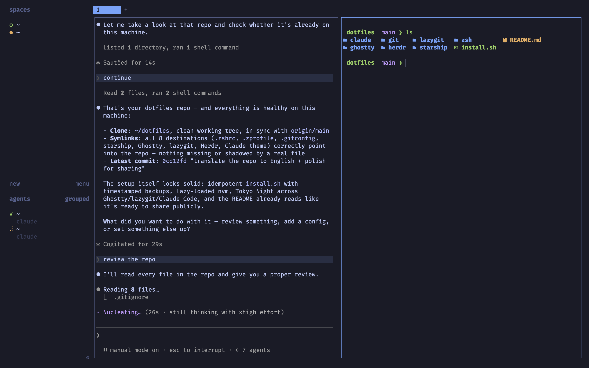

# dotfiles

A beautiful, comfortable and blazing-fast terminal workspace for macOS — **Tokyo Night everywhere**.



## What's inside

| Folder | File | Linked to |
|--------|------|-----------|
| `zsh/` | `.zshrc`, `.zprofile` | `~/.zshrc`, `~/.zprofile` |
| `git/` | `.gitconfig` | `~/.gitconfig` |
| `starship/` | `starship.toml` | `~/.config/starship.toml` |
| `ghostty/` | `config` | `~/Library/Application Support/com.mitchellh.ghostty/config` |
| `lazygit/` | `config.yml` | `~/Library/Application Support/lazygit/config.yml` |
| `herdr/` | `config.toml` | `~/.config/herdr/config.toml` |
| `herdr/` | `plugins/worktree-setup.toml` | `~/.config/herdr/plugins/config/tdi.worktree-setup/config.toml` |
| `herdr/` | `bin/herdr-project` | `~/.local/bin/herdr-project` |
| `herdr/` | `plugins.txt` | installed with `herdr plugin install` |
| `ai/` | `AGENTS.md` | `~/.codex/AGENTS.md`, imported by `~/.claude/CLAUDE.md` |
| `ai/` | `hooks/session-briefing.sh` | `~/.claude/hooks/`, registered in `~/.codex/hooks.json` |
| `ai/` | `skills/handoff/` | `~/.agents/skills/handoff`, mirrored into `~/.claude/skills/` |
| `ai/` | `codex/rules/safety.rules` | `~/.codex/rules/safety.rules` |
| `ai/` | `bin/codex-agents-sync` | `~/.local/bin/codex-agents-sync` |
| `claude/` | `themes/*.json`, `statusline.sh`, `CLAUDE.md` | `~/.claude/` |

## The stack

- **Terminal:** [Ghostty](https://ghostty.org) — Tokyo Night theme, FiraCode Nerd Font, frosted-glass background, global quick terminal on <kbd>⌘</kbd><kbd>`</kbd>
- **Workspace manager:** [Herdr](https://herdr.dev) — panes and workspaces built for AI coding agents, with lazygit popup, diff-review sidebar and Linear worktree shortcuts
- **Shell:** zsh + [Starship](https://starship.rs) one-line prompt + autosuggestions + syntax highlighting
- **Modern CLI:** eza · bat · fzf · zoxide · fd · ripgrep · git-delta · lazygit · neovim
- **Node toolchain:** fnm (auto-switches versions on `cd`) · ni (picks npm/pnpm/yarn from the lockfile) · direnv (per-project env vars)
- **Coding agents:** Claude Code and Codex side by side, sharing one set of global instructions, skills, session briefing and guardrails (see below)
- **Claude Code:** custom TUI theme + finely calibrated scrolling (1 line per wheel event, no acceleration)
- **Usage at a glance:** both agents show model, folder, branch, context used, the 5h and weekly plan limits and the session cost under the prompt (`claude/statusline.sh` for Claude Code, the `[tui] status_line` items `install.sh` writes for Codex)

## Fast by design

- **fnm** — Rust-fast Node version manager: instant shell startup and automatic version switching when you `cd` into a project with `.nvmrc`
- **Cached compinit** — completions do a full re-scan at most once a day
- **One-line prompt** — no powerline, no gradients, nothing slowing you down
- **Git on autopilot** — `push.autoSetupRemote`, `pull.rebase` + `autoStash`, `rerere` (remembers conflict resolutions), pruned fetches, recency-sorted branches — plus fuzzy `gco`/`glog` helpers

## Working in Herdr

Every project lives in its own Herdr workspace with a coding agent in the
root pane. <kbd>ctrl+b</kbd> <kbd>shift+o</kbd> opens a fuzzy picker over every
git repo under `~/Documents`, ranked by how often you visit it with zoxide.
Picking one focuses its workspace if it is already open, or creates it and
starts Claude Code there (<kbd>ctrl+x</kbd> in the picker starts Codex
instead; `HERDR_PROJECT_AGENT=codex` swaps the default). The sidebar shows
each agent's current task title, and a macOS notification fires when a
background agent finishes or needs you.

| Keys (after <kbd>ctrl+b</kbd>) | Action |
|------|--------|
| <kbd>shift+o</kbd> | open project with Claude (<kbd>ctrl+x</kbd> in the picker: Codex, <kbd>ctrl+s</kbd>: plain shell) |
| <kbd>o</kbd> | jump to the agent that just notified you |
| <kbd>a</kbd> / <kbd>shift+a</kbd> | next / previous agent, across workspaces |
| <kbd>w</kbd> | workspace picker |
| <kbd>shift+g</kbd> | new git worktree workspace, prepared by `plugins/worktree-setup.toml` |
| <kbd>alt+l</kbd> | Linear issue → worktree + workspace |
| <kbd>alt+r</kbd> | review the agent's diff (reviewr) |
| <kbd>shift+f</kbd> | file tree and diffs |
| <kbd>alt+g</kbd> | lazygit popup |
| <kbd>?</kbd> | every binding |

`install.sh` also installs the plugins listed in `herdr/plugins.txt`, the
Claude Code and Codex integrations (agent state in the sidebar, session
resume after restarts) and Herdr's own agent skill, so you can ask either
agent to "use Herdr to run the tests in a pane beside me". Herdr is upgraded through Homebrew; run `./install.sh` again after
`brew upgrade herdr` so the integration and the skill follow the new version.

## One setup for Claude Code and Codex

Both agents run on this machine, often on the same repository in two panes,
so everything that is not specific to one of them lives once in `ai/`.
`ai/AGENTS.md` holds the global instructions: Codex reads it as
`~/.codex/AGENTS.md`, and `claude/CLAUDE.md` imports it with
`@~/dotfiles/ai/AGENTS.md` before a few Claude-only lines.

Skills follow the open Agent Skills layout. `~/.agents/skills` is the single
home of personal skills (Codex reads it, `npx skills add` and `gitnexus setup`
install there), and `install.sh` links each of them into `~/.claude/skills`,
replacing old identical copies. Projects do the same with
`<repo>/.agents/skills` and links in `<repo>/.claude/skills`.

Claude agents (`~/.claude/agents/*.md`) become Codex custom agents through
`ai/bin/codex-agents-sync`, which writes a thin `~/.codex/agents/<name>.toml`
per agent that points Codex at the markdown file instead of copying it, so
the two never drift. Codex has no deny list in settings, so
`ai/codex/rules/safety.rules` forbids the same commands Claude's `deny` list
does (migrations, `psql`, force pushes, `terraform apply`).

## Agents remember where you stopped

Claude Code keeps a per-project auto memory for durable facts and decisions.
Two pieces here cover the part it misses, the work still in flight, for both
agents.

`ai/hooks/session-briefing.sh` runs on every `SessionStart` inside a git
repo and hands the agent the branch, its drift from upstream, the last commits,
the uncommitted files and the latest handoff note, in about 150ms. It also
warns when a project's `MEMORY.md` gets close to the 200 line / 25KB load
limit, so the index never gets silently cut.

The `handoff` skill (`/handoff` in Claude, `$handoff` in Codex, or just say
you are stopping for the day) overwrites one note per repository in
`~/.local/state/ai-handoff/` with the goal, the current state, the next step
and the traps, and promotes anything durable into proper memories. A note
written by Codex is read by the next Claude session and the other way
around. The next session in that repo, or in any of its
worktrees, starts with that note for ten days.

For large projects, keep `CLAUDE.md` lean and move module detail into
`.claude/rules/*.md` with a `paths:` frontmatter, so each file only enters
the context when Claude reads code in that area.

## Searchable session archive (ai-memory)

[ai-memory](https://github.com/akitaonrails/ai-memory) captures every Claude
Code session through lifecycle hooks, redacts credentials, and keeps a
git-versioned markdown wiki plus an FTS/vector index you can search from the
CLI or through its MCP tools. It runs as a 13MB loopback server without any
LLM or API key.

Install the native bundle from the GitHub release into
`~/.local/share/ai-memory` (binary plus `hooks/` and `packaging/`), symlink
the binary into `~/.local/bin`, run `ai-memory init`, then `./install.sh`
renders `ai-memory/launchagent.plist.template` and loads the LaunchAgent.
Wire a project with `ai-memory install-hooks --agent claude-code
--project-strategy repo-root` and `claude mcp add --transport http ai-memory
http://127.0.0.1:49374/mcp -s local`, run once from inside the repo; the
hooks go in that project's `.claude/settings.local.json`, so only opted-in
projects are captured.

## Install on a new machine

```bash
# 1. clone
git clone https://github.com/GustavoGJesus/dotfiles ~/dotfiles

# 2. install everything: Brewfile (tools, apps, font) + symlinks
cd ~/dotfiles && ./install.sh
```

Requires [Homebrew](https://brew.sh). The `Brewfile` declares the whole
toolchain; `install.sh` runs it automatically and then creates the symlinks.

> **Using this repo yourself?** Set your own identity in `git/.gitconfig`
> (name and email) before running `install.sh` — otherwise you'll be
> committing as me. 🙂

## How it works

`install.sh` creates **symlinks** from this repo to the place each tool expects.
The real files live here; the system just points at them. Editing anywhere =
editing the repo — then it's just a `git commit`.

Running `./install.sh` again is always safe (idempotent). Any real file found
at a destination is moved to `~/.dotfiles-backup/<timestamp>/` first.

## Updating after a change

```bash
cd ~/dotfiles
git add -A && git commit -m "tweak <file>" && git push
```
